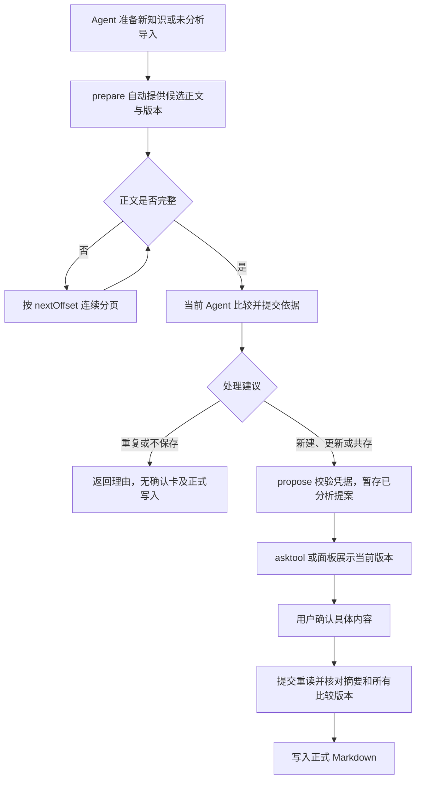

# pi.project-memory — 重设计说明

> 这是对 `axc00.project-knowledge` v0.3.3 的重设计。**思路不变，实现重写。**
> 原始审计与机制解读见同目录上级的两份文档。

---

## 1. 锁定的设计决策

| # | 决策 | 取值 |
|---|---|---|
| 1 | 定位 | 保留「项目内 Markdown + 被动注入 + 人工确认」三大原则，重写实现 |
| 2 | 写入闸门 | **必须用户确认才写入**，模型不能代替用户确认 |
| 3 | 检索 | **纯关键词，零网络依赖** |
| 4 | 记忆类型 | 6 种 `kind`（见 §3） |
| 5 | 注入架构 | 保留 `agent.extension` 被动注入；扩展自带受限 fs |
| 6 | 作用域 | **严格 per-project**，无全局层 |
| 7 | 插件 id | `pi.project-memory` |
| 8 | 验证 | 单元测试用 `node --test` 跑；插件本体不安装、不启动 |

### 相对原作的取舍

- **去掉 `net.fetch`**：原作的 Jev 去重需要外部 API。重设计改为纯本地启发式去重，**权限从 6 项降到 5 项，且完全无网络**。
- **换存储路径**：`.workflow/knowhow` → `.workflow/memory`。不兼容原作格式（未选择该项）。
- **多文件布局**：原作把 800 行塞进单个 `core.js`。重设计拆成 `core/` 下 5 个模块 + `fs-guard.js`，每块可独立测试。

---

## 2. 与原作的关键差异（全部为修复或加强）

| 类别 | 原作 | 本设计 |
|---|---|---|
| 幂等性 | 靠「把批次写回 inbox」保证重试不重复，但该写盘失败被静默吞掉 → 可能产生重复条目 | **`batchRef` 写入条目 frontmatter，重试时反查已落盘条目**，不依赖 inbox 写盘成功 |
| 注入净化 | 只有自动注入块做去尖括号+截断；卡片标签、asktool 问题、`spec-entry sid` 未净化 | **单一净化函数 `sanitize()`**，所有「仓库数据 → 模型/卡片」出口统一调用；`id` 加格式白名单 |
| 分词 | `EN_STOP` 含 `file/code/function/class/error/type/...` → 代码关键词永不命中；单字中文/假名/韩文查询返回空 | 停用词表只留真实英语功能词；脚本覆盖扩展到假名/谚文；**单字回退** |
| 词边界 | `String.includes` → `know` 命中 `knowledge` | ASCII 词用**词集合**精确命中，CJK 保留子串匹配 |
| 排序确定性 | `localeCompare` 决定重复 id 胜出与同分排序，依赖宿主 ICU | **code-unit 比较**，跨机器一致 |
| 缺失判定 | 消息正则兜底，权限错误被当「缺失」静默跳过 | **只用结构化 error code** |
| 日期 | `toISOString()`（UTC），本地跨零点差一天 | **本地日期** |
| 循环上限 | `while (await io.exists(...))` 无上限 | 加上限，超出抛错 |
| 读取预算 | 只有单文件 256KB 与 2000 文件上限 → 最坏 512MB | 增加**总字节预算**（16MB），超出提前停止 |
| 路径防护可测性 | 防护内联在 `extension.js` 中，无法从外部测试 | 抽成 **`fs-guard.js`**，可独立单元测试 |
| 性能 | 每个查询词两次全量扫池、每次 4 次 `includes`；`_norm` 缓存挂在共享对象上 | **WeakMap 缓存 + 词集合**，一次遍历 |
| 上下文成本 | 注入仅检索层 | 关键正文优先地图/pinned，当前每请求新增最多 8,000 字符；历史摘要预算见 §4 |

---

## 3. 数据模型：6 种 kind，一套机制

关键判断：**六种记忆的存储形态与检索机制完全相同，只有渲染模板与注入优先级不同。**
所以是「一套系统 + 六种模板」，不是六套系统。

| kind | 语义 | ID 前缀 | 建议结构 | 默认注入层 |
|---|---|---|---|---|
| `lesson` | 事实型经验 | `LSN` | 症状 / 根因 / 修法 / 相关文件 | 检索 |
| `rule` | 项目规则、约束 | `RUL` | 规则 / 理由 / 适用范围 | 检索（可 pin） |
| `decision` | 决策记录 | `DEC` | 背景 / 选项 / 决定 / 后果 / 重审条件 | 检索 |
| `procedure` | 程序型（怎么做一件事） | `HOW` | 前置 / 步骤 / 验证 | 检索 |
| `map` | 项目地图（**单例**） | `MAP` | 模块 / 入口 / 关键路径 | **常驻** |
| `preference` | 项目内偏好 | `PRF` | 偏好 / 理由 | 检索（可 pin） |

### 两个风险与对策

| 风险 | 对策 |
|---|---|
| 模型选错 kind | ① `propose` 的 JSON schema 用 `enum` 硬约束；② 系统提示给出明确判定标准；③ 卡片上显示 kind 让用户可纠 |
| 常驻层膨胀撑爆上下文 | 当前自动正文每请求新增最多 8,000 字符；每块最多三条、每条最多 2,000，提供版本及截断；超出条目不保证出现 |

---

## 4. 注入模型（第五阶段当前实现）

生产 before_provider_request 提供有限的当前正式正文及临时 memory-task 索引。pinned/map 优先，其后是按任务目标和当前请求检索的条目；草案及 inbox 内容不作为批准事实。

每个请求最多新增 8,000 UTF-16 字符，最多重放最后两个各 4,000 字符的阶段块；每块最多三条正文、每条 2,000，附来源/hash/提供字符数/总字符数/完整性。正文以 JSON 转义尖括号，任务描述净化；截断需 load。构造器上限 8,000，生产正文传入 3,998，为消息分隔预留两个字符；失败出口同样遵守传入预算。

阶段键是 taskId/contextRevision/recovery generation；同阶段重复请求使用相同字节，不附变化时间戳。新阶段可重读当前正式版本。缓存每会话最多二十块、一百消息索引；最多二百会话。失败每阶段重试一次，随后等待新阶段或续接。

宿主需从原始历史重建 payload；不能把钩子返回的增强消息回灌为原消息。旧摘要缓存入口仅保留在原测试的依赖注入接口；生产运行使用任务正文路径。历史摘要上限 8 条/1,200 字符不再是生产自动上下文预算。

## 5. 工具

| 工具 | 输入 | 输出 |
|---|---|---|
| `search` | `query`, `kind?`, `limit?` | ID + 标题 + 一行摘要（不含正文）；失效条目排除 |
| `load` | `id` | 单条全文 + `trust` 标注；已失效时附警告 |
| `prepare` | `action=prepare/page/pending`；`items[]` 或 `importBatchId`；分页用 token/id/offset | 自动提供候选正文、版本与命中理由；纯只读 |
| `task` | `action=begin/checkpoint/finish/status`、目标/阶段/结论/理由 | 临时任务检查；status 只读，变更经真实工具结果同步 |
| `propose` | `reviewToken` + `decisions[]`；旧 `items[]` 入口只准备 | 暂存已分析批次 + asktool 卡片参数；**不写正式记忆** |

实际工具名带宿主前缀：`plugin_pi_project_memory_<name>`。

`propose` 的工具描述内含卡片语言规范（`core/language.js`）：模型写 `title`/`content`/`keywords` 时遵守——干净终态、完整双字词、标识符保持英文原文。

---

## 6. 存储

```
.workflow/memory/<ID>.md              所有 kind 的条目
.workflow/memory-inbox/<KB-uuid>.json 待确认批次（自带 .gitignore，内容为 *）
```

条目格式：

```markdown
---
id: LSN-20260921-teammate-model-config
kind: lesson
title: 队友模型配置在 .env 里被覆盖
keywords: [模型, 配置, model, override]
status: active
pinned: false
created: 2026-09-21
supersedes: LSN-20260901-old
related: [DEC-20260801-choose-env]
batchRef: 3f9a1c2b
---
症状：…
根因：…
修法：…
相关文件：…
```

- `status ∈ {active, deprecated, superseded, archived, retired}`；失效条目不参与检索，但**文件保留**。
- `batchRef` 只用于幂等重放，不出现在注入内容里。

---

## 7. 确认闭环



选项（按 item 的 kind 生成）：

| 选项 | 语义 | 落盘 |
|---|---|---|
| **新建** | 没有条目覆盖 | 写新条目 |
| **更新 X** | 同 kind 同话题，新结论替代 | 写新条目 + 旧条目 `deprecated` + `supersededBy` |
| **与 X 各自成立** | 不同条件下都成立 | 写新条目 + 双向 `related` |
| **与 X 重复** | 同一件事 | 不写 |
| **不保存** | 无价值 | 不写 |

`map` 是单例：空缺时允许新建标准 `MAP.md`；存在唯一有效且位于标准路径的地图时允许更新。地图目标直接从语料取出，不依赖关键词命中。提交检查去重前的可访问语料及标准路径占用；退役、异位、重复地图或其他内容占用 `MAP.md` 时明确拒绝，不自动恢复、覆盖或迁移。普通列表仍保持同 ID 首见优先；此检查受现有文件和总字节预算约束。

### 第五阶段任务生命周期（未发布）

任务检查模块独立于正式知识。task 工具在 main.js 验证后返回会话/输入/事件摘要凭据，只有扩展实际 tool_result 才应用命令。tasks.js 通过现有项目票据保存短状态；task-context.js 只读正式语料构造有预算的上下文。扩展用项目+sessionId 隔离并串行事件；面板 task.status 只读展示。

.tasks.json 保留三十天、一百项、240,000 UTF-8 字节；每任务最多二十四个版本/最近操作、十个待审身份。readTasks 恢复字段白名单，忽略过期/损坏状态并提示。自动临时更新获单独授权：扩展没有 mode，因此无法区分 Agent/Plan/Goal。显式 Plan/Goal search/load/prepare 和 task status 连同工具结果追踪零写入；正式批准不受此授权影响。任务状态等待两秒，持有者判定继续沿用保守票据规则。

显式 begin 确定新边界，历史未完成任务暂停；长 Continue/继续 消息保留当前 taskId/阶段/待审。当前与历史 pending 仅过滤自己的真实未决定批次，不吸收其他会话提案；只读诊断核对返回值，自动事件在协调内保存。失败保持原引用并提示。

before-compact 保存已有索引；compacted 只标记恢复待执行，下一请求加载当前正式正文；没有用户消息时附一条清晰标记的数据消息，不修改助手摘要。失败/停用不清除恢复需要；检索失败每阶段额外重试一次。事件返回 undefined，不取消压缩、没有隐藏 Agent。agent_end/turn_end/agent_settled/session_shutdown 只能标记漏查，不能强制语义收尾。input 事件未发出，宿主历史接口为空，不作为推断依据。

surfaced/provided/usedClaimed 分开记录，可验证提供版本，不能验证理解。Write/Edit/Bash 成功结果保守标记 dirty，只保存调用 ID，不保存命令或输出。实际安装态及真实长任务/重启未验证；参见[生命周期样例](docs/usage/2026-10-11-memory-lifecycle.md)。

### 第四阶段审批与决定去重（2026-10-11，未发布）

`review.js` 构造当前版本的完整展示模型，行级 LCS 差异计算最多 160,000 单元和合计 1,600 行；超过预算仍完整并列提供原文。`renderer/ui.js` 为可独立测试的转义渲染与双语文本，`renderer/app.js` 管理交互、默认未审、稳定 itemId 草稿及焦点。聊天卡片显示有限旧新片段、推荐动作、目标、变化、范围与依据，所有文本仍绑定完整批准摘要。

reviewStateOf 区分 unreviewed/deferred/rejected/duplicate/approved；savedAs 是已经写入的批准状态。未提交项不形成决定，暂缓只记录 reviewStatus 且保持 pending。未分析批次只允许明确 defer/skip，不可保存；已分析的新流程每项新写入要求 item.analysis。旧兼容批次仍通过既有公开核心接口规则测试，面板/聊天展示会要求第三阶段分析。

用户可明确标记已完整比较候选为重复（非写入）；只有已分析推荐写入可直接批准。inbox.revise 在原展示 token 下保存新正文/可选 origin/scope/合法 requestedAction，清除分析和旧批准；当前 Agent 必须比较请求动作。用户指定的合法目标即使被展示排序移出仍纳入三条准备候选；目标失效则明确拒绝，不静默切换。

core/decisions.js 使用内容（保留大小写/缩进）、类型、标题、关键词、置顶、范围、来源、动作、证据和比较版本计算 SHA256 指纹。账本在 inbox 内，只存指纹/状态/短理由/actor/时间，不存正文或对话；保留 30 天、最多 1,000 项和 240,000 UTF-8 字节，先按时间裁剪，再按大小裁剪。损坏和 IO 失败产生提示；账本永远不是批准信任根。

新建提案在进程内串行比较近期拒绝/重复及同项目现有待审指纹；相同待审返回身份而不返回新卡，近期拒绝默认抑制。不同证据/版本/内容、过期、用户明确 reReview 允许重审；不能绕过准备或真实用户批准。面板/扩展的用户决定及扩展真实 propose 事件的 Agent 重复分析在项目票据中写账本，actor 明确区分。外部编辑、篡改账本或未加入锁的进程不受本插件协调保证。

origin 和 scope 是可选正式说明，source 保持文件路径含义。正式 view 展示 supersedes/supersededBy/related 与共存条件；元数据修改仍受 baseHash 保护。实际浏览器验证使用离线 Chromium 和 bridge 夹具，不等同安装态宿主验证。

### 第三阶段比较协议（2026-10-11，未发布）

`comparison.js` 是零 IO 的会话凭据模块。每次准备最多提供 24,000 UTF-16 字符，每个候选首段或每页最多 8,000；不完整正文使用精确 nextOffset 连续分页，共享候选使用统一覆盖进度。候选仍由本地同类型前三条发现，返回窗口受限和无命中说明；跨类型只给提醒。凭据最多 100 份、三十分钟过期，绑定会话、候选来源及原文件 SHA256。

当前 Agent 提交 action/targetId/reason/same/changes/scope/evidence，以及可选整理后的 content。新建、更新、共存和语义重复必须完整提供必要候选版本；确定性重复和 skip 可结束而不写正式记忆。最终正文保持准备时的类型、标题和关键词，重新核对候选资格；出现新候选须重新准备，确定性重复不生成写入卡。插件证明已提供正文与版本，不证明 Agent 理解、推理或证据陈述正确。

`propose` 校验后在任何异步副作用前消费凭据；IO 失败要求重新准备。写入建议只提供分析过的动作与不保存，替代动作需重新比较。分析和选项进入提案 digest，所有比较版本在正式提交时再次核对；新建也不能沿用变化后的比较依据。

导入及重启后失去内存分析信任的批次保持 unanalysed。纯 `refreshBatch` 恢复已写入身份且保留原操作、savedAs、decided、itemId；prepare 只分析剩余条目，不写磁盘；propose 合并回原批次。卡片仅显示未处理条目，标记保留原批次绝对索引，扩展按完整标记查找。没有活跃 Agent 时不启动后台分析。

search/load/prepare 声明非空 planSafeActions 与 schema action.enum；Plan/Goal 要求显式 action，search/load 跳过热度写入，prepare/page/pending 所有模式零磁盘写入，propose 仅 Agent 模式。宿主安装态尚未验证。第四阶段已补全差异和决定去重；第五阶段处理生命周期及零工具调用的关键正文自动提供。参见[实际工具链样例](docs/usage/2026-10-11-memory-comparison.md)。

### 第二阶段保护决策（2026-10-11，未发布）

两个执行进程共用受限 Node 文件层和 Lamport 写入票据，原子独占创建及原子替换保证参与者互斥；等待十秒超时并支持取消，只清理确认退出的 PID，未知/活跃持有者不抢占。面板根目录固定到本次可见项目，Agent 提议暂存仍使用宿主会话文件网关，避免混用项目。自带 Node 操作不经宿主逐次审计，范围限制与根目录身份保护由 fs-guard.js 执行；外部编辑和其他进程不受此票据约束。

revision 2 批次带稳定 itemId，完整展示摘要覆盖内容、选项和目标 baseHash。聊天核对真实 propose 返回及实际 asktool 调用；面板使用进程内项目/摘要 token。提交重读，过期则拒绝。旧批次仅在重新展示时升级，重启前批准不能继续使用。正式条目写 batchId/itemId/commitKey；按身份恢复，不按标题恢复，重试不得更改原操作；关联已完成时不重复写，未完成时只在旧目标版本未变时补写。

### 第一阶段规则决策（2026-10-11，未发布）

提交将所有持久化选项视为不可信数据：先检查 action/key/target 结构、批内唯一性和地图数量，再用当前语料核对所选目标的类型、有效性和本地候选资格。展示候选只保留前三条，提交合法性不依赖该排序位置；全部选择通过后才改变决定状态。

确定性正文比较统一换行符并去掉整体首尾空白，保留代码大小写、Unicode 和正文内部缩进；命中的重复正文先于标题与关键词候选展示。相同标题仅提供候选和显式更新选项，不默认推荐弃用旧知识。选择本地确定性规则以保持零网络依赖；语义比较、批准版本绑定和跨进程互斥分别属于后续阶段，本段不提供这些保证。

答案匹配：把卡片标签与用户输入都先归一化（NFKC / 大小写 / 空白折叠），再剥掉「推荐 · 」装饰，然后全等比较。手打一遍标签也能命中；匹配不上时回显卡片上可用的标签，不做任何语义猜测。

---

## 8. 权限

| 权限 | 用途 |
|---|---|
| `agent.tool.register` | 注册 5 个工具 |
| `agent.extension` | 被动注入 + 确认后写入 |
| `fs.read` | 面板读取待确认批次（scope `.workflow/**`） |
| `fs.write` | 面板保存（scope `.workflow/memory/**`、`.workflow/memory-inbox/**`） |
| `ui.panel` | 备用审查面板 |

**没有 `net.fetch`；已声明 `fs.delete`。** 管理视图确认后可删除条目，已处理的批次和写入票据会清理。正式写入共用自带受限文件层，其操作不经过宿主逐次文件权限审计。

---

## 9. 模块划分

```
plugin/
  manifest.json
  main.js           插件进程：5 个工具 + 面板后端 + 设置
  extension.js      agent 扩展：注入钩子 + 确认写入
  fs-guard.js       受限文件访问（可独立测试）
  comparison.js     会话凭据 / 自动正文 / 建议验证
  approval.js       展示凭据 / 纯快照恢复
  write-coordinator.js  跨进程写入协调
  core/
    index.js        统一导出
    text.js         归一化 / 截断 / 净化 / frontmatter / YAML
    entries.js      kind 定义 / 解析 / 语料装载 / ID 生成
    search.js       分词 / 打分 / 注入块渲染
    batch.js        批次 / 卡片 / 确认 / 提交
    i18n.js         中英文案
    memory.js       视图的卡片模型 / 统计 / 编辑校验 / 删除目标校验
  tasks.js          有限期临时任务状态与检查
  task-context.js   当前正式正文与请求预算
  review.js         版本化审批展示与有上限的全文差异
  core/decisions.js  项目旁路决定指纹与有限期保留
  renderer/index.html   确认面板外壳
  renderer/ui.js        审批转义渲染 / 双语说明
  renderer/app.js       决定与修改 / 草稿与焦点
  views/
    index.html      项目记忆视图：外壳与样式（自包含）
    ui.js           纯渲染与筛选，所有转义规则在这里
    app.js          视图接线：状态与通道往返，不拼任何字符串
test/               node --test 单元测试
```

`core/` 是纯逻辑层：**零 IO、零网络**，io 由调用方注入。这让它可以完全用内存假对象测试。

## 第六阶段验证状态（未发布）

四条实际 createProjectFs 文件层联合测试贯通 main 工具、extension 真实回调接口的卡片事件夹具、面板批准、旧语料/旧批次、导入/暂缓/拒绝去重、并发编辑、目标 stale 和压缩恢复；全量 352/352 通过。离线 Chromium 九组 DOM 检查通过，PluginCheck 校验二十九文件通过，警告高风险权限需用户授权；暂存已核对并清理。没有 PluginPack、安装或发布。

成本脚本测量 UTF-16/UTF-8 字符与字节，未运行 tokenizer：自动续接新增 7,698 字符，重复字节稳定；prepare 正文 24,000，含结构的 JSON 26,393。因此正文预算不等同全部工具输出预算，provider 计费/缓存命中仍未测。实际安装验收未执行，不能宣称宿主完整进程/用户点击/真实长任务已经验证。详见[发布准备报告](docs/usage/2026-10-11-release-readiness.md)。

## 10. 界面：工作面板视图

0.2.0 新增的第二个界面。它与确认面板是分工而非合并：确认面板负责写入前的裁决，视图负责已入库记忆的管理。

### 为什么是停靠视图

宿主的插件 UI 面只有两个。`ui.panel` 是独立浮动窗，一个插件一个，没有自动按钮，只能靠启动器、命令或工具调用打开。`ui.view` 停靠在工作面板里，自动出现在面板头部菜单，并按当前项目过滤。侧边栏按钮、工具栏按钮、状态栏、右键菜单项、模态框，宿主都没有对应 API。因此跟项目绑定的按钮只能是 `contributes.views`。

### 三个模块

    views/index.html   外壳与样式（自包含，零网络）
    views/ui.js        纯渲染与筛选，所有转义规则在这里
    views/app.js       接线：状态、通道往返、DOM 移动，不拼任何字符串

拆成三层只为一件事：转义规则必须可测。`ui.js` 不碰 DOM，可以被 `node --test` 直接 require，并用敌意语料做 XSS 回归。`app.js` 只负责什么时候调哪个通道、调完把什么放上去，用最小 DOM 桩即可覆盖它的交互契约。

### 数据流：页面只能拉

宿主没有推送到面板的 API，页面里也没有 `pi` 对象，只有 `window.pluginBridge`。所以视图是拉取式的：打开时 `memory.list` 一次，编辑时 `memory.get`，保存 `memory.update` 并用返回的卡片原地替换，删除 `memory.delete` 后本地移除。每次变更后再拉一次统计，因为计数由插件进程算，页面不复算。

筛选与搜索不走进程：`memory.list` 一次拿回全部卡片，之后的过滤是页面本地的子串匹配。理由是搜索框每敲一个字都不该触发一次全量读盘。它与 `core/search.js` 的检索排序刻意不同，两者回答的问题不同。

### 删除：唯一被放宽的权限

`fs.delete` 是相对 0.1.0 唯一新增的危险权限。边界如下。

1. 页面只发条目 id，没有任何通道接受路径。
2. 进程用 id 在刚加载的语料里找到条目，取它的 `source`。
3. `core.deleteTarget` 再复核：必须在 `.workflow/memory` 之下，必须是 `.md`，不含 `..`、反斜杠、空字节或空路径段。
4. 之后在项目写入票据内调用受限 Node 文件层，传入的 baseHash 不一致时拒绝；其操作不经宿主逐次文件权限审计。
5. 同一 id 的编辑与删除互斥，两个点击不会交错读写。
6. Agent 扩展拿不到这条路径：它的 `io.remove` 仍被限制在存放已处理批次的 `.workflow/memory-inbox`。

### 已知取舍

- `map` 条目按定义始终置顶，界面不给取消置顶的按钮：格式会把它顶回去，给了就是骗人。
- 删除确认在按钮上原地翻转（再点确认、点外边或 Escape 取消），无浮层；时间线行与卡片一致。
- 跨项目是独立复制：卡片复制按钮导出文件原文，导入框粘贴后进待确认批次；`id`/日期/链接不跨项目，无全局层、无同步。
- 自动任务正文提供不记录热度；Agent 显式 search/load 和管理视图读取仍记录。历史摘要注入测试入口保留热度兼容。
- 阅读热度是旁路账本 `.workflow/memory-inbox/.heat.json`（`{id: {hits, lastAccess}}`，读脏回空，上限 2000 条），`search`/`load`/`memory.get`时 touch，失败不影响读；视图 `hot` 排序按 hits→lastAccess，时间线模式是纯 chronology 分组（无 pinned 置顶）。
- 视图的搜索是子串匹配，与 Agent 的检索排序结果不一致，这是有意的。
- 深浅主题跟随宿主：`app.getAppearance` 的 base 落成 `data-theme`，宿主没解析出偏好时退回 `prefers-color-scheme`。宿主推送的 `appearance:changed` 只带 locale，所以收到它时会再取一次外观。
