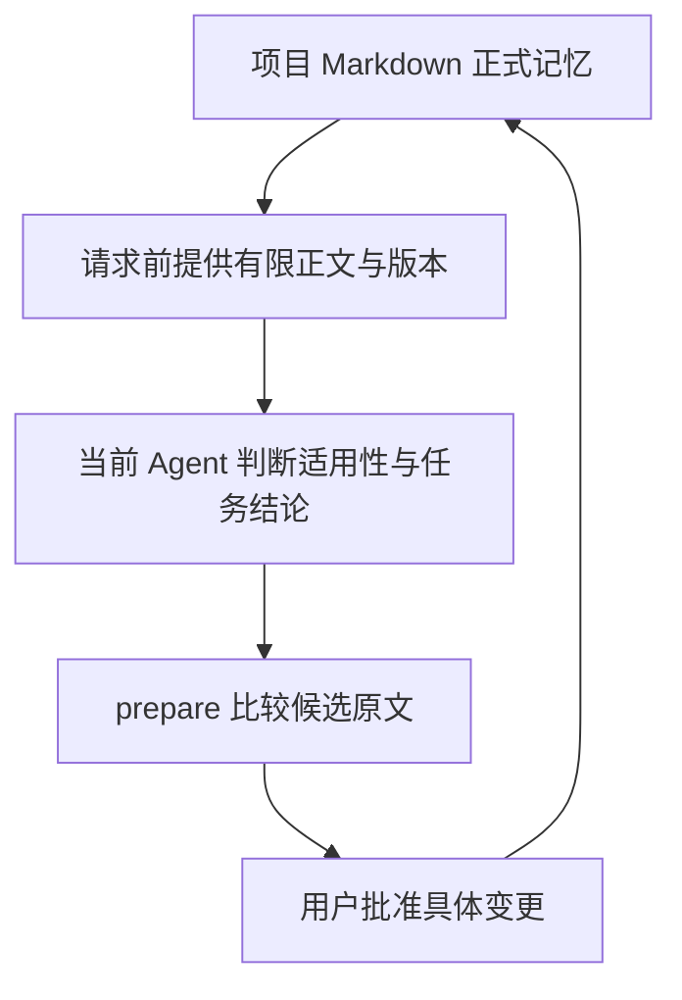

# pi.project-memory

PI-Desktop 插件「项目记忆」的重设计实现。**思路不变，实现重写。**

原插件：`axc00.project-knowledge` v0.3.3。

当前版本 **0.3.0**：本地候选原文比较、版本绑定审批、完整差异与决定去重、有限自动正文及任务恢复。实际安装态验收尚未完成；安装包及校验值见 [`dist/README.md`](dist/README.md)。

- 设计说明 → [`DESIGN.md`](DESIGN.md)
- 分段改进计划 → [`docs/plans/2026-10-10-memory-workflow-improvement.md`](docs/plans/2026-10-10-memory-workflow-improvement.md)
- 第三阶段工具链样例 → [`docs/usage/2026-10-11-memory-comparison.md`](docs/usage/2026-10-11-memory-comparison.md)
- 第四阶段审批与验证 → [`docs/usage/2026-10-11-memory-review.md`](docs/usage/2026-10-11-memory-review.md)
- 第五阶段任务与恢复 → [`docs/usage/2026-10-11-memory-lifecycle.md`](docs/usage/2026-10-11-memory-lifecycle.md)
- 第六阶段联合验证与发布准备 → [`docs/usage/2026-10-11-release-readiness.md`](docs/usage/2026-10-11-release-readiness.md)
- 插件本体 → [`plugin/`](plugin/)
- 测试 → [`test/`](test/)
- 打包产物 → `dist/pi.project-memory-<version>.piplug`

## 这是什么

把「项目记忆」做成仓库里的普通 Markdown 文件，用关键词检索在模型请求前提供有限的当前正文及任务索引，用「人在环」的卡片确认写入。




## 目录结构

```
plugin/            会被打包进 .piplug 的内容
  manifest.json
  main.js          插件进程：5 个工具 + 两个界面的后端 + 设置
  extension.js     agent 扩展：注入钩子 + 确认写入
  fs-guard.js      受限文件访问（独立可测）
  comparison.js    会话内比较凭据、正文预算与建议校验
  tasks.js         临时任务状态、检查与恢复
  task-context.js  当前正式正文与上下文预算
  review.js        完整审批展示与有上限的行级差异
  approval.js      展示版本与批次恢复
  write-coordinator.js  项目级写入票据
  core/
    index.js       统一导出
    text.js        归一化 / 截断 / 净化 / frontmatter
    entries.js     kind 定义 / 解析 / 语料装载 / ID 生成
    search.js      分词 / 打分 / 注入块渲染
    batch.js       批次 / 卡片 / 确认 / 提交
    i18n.js        中英文案
    memory.js      视图的卡片模型 / 统计 / 编辑校验 / 删除目标校验
  renderer/index.html   确认面板外壳
  renderer/ui.js        审批渲染 / 双语文本
  renderer/app.js       明确决定 / 编辑草稿 / 焦点
  views/
    index.html     项目记忆视图：外壳与样式（自包含）
    ui.js          纯渲染与筛选，所有转义规则在这里
    app.js         视图接线：状态与通道往返，不拼任何字符串
test/              node --test 单元测试
docs/              审计报告与机制解读（本次重设计的输入）
dist/              打包产物
```

## 开发

不需要安装任何依赖，`node --test` 直接跑（Node 22+，自动发现 `**/*.test.js`）：

```powershell
node --test
```

打包需要宿主仓库的 devkit（本仓库不含构建工具链）：

1. 把 `plugin/` 复制到 PI-Desktop 工作区内的一个临时目录；
2. 用 PI-Desktop 的 `PluginCheck` / `PluginPack` 校验并打包；
3. 把 `dist/*.piplug` 取回本仓库的 `dist/`。

## 与原创的差异

见 [`DESIGN.md` §2](DESIGN.md)。摘要：修掉幂等性漏洞与注入面，重做分词与词边界，去掉全部网络依赖，把安全层抽成可测试模块，新增常驻注入层与六种记忆类型。

## 许可

MIT。
