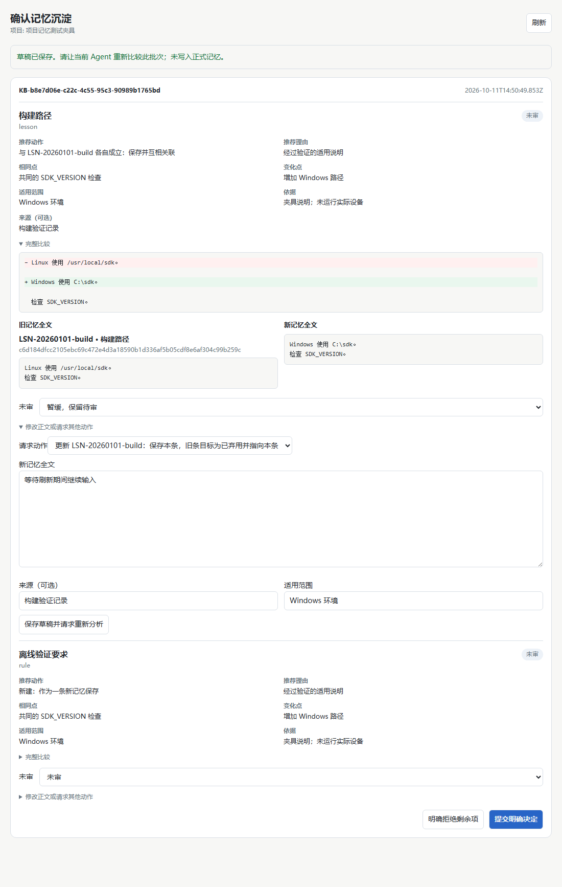
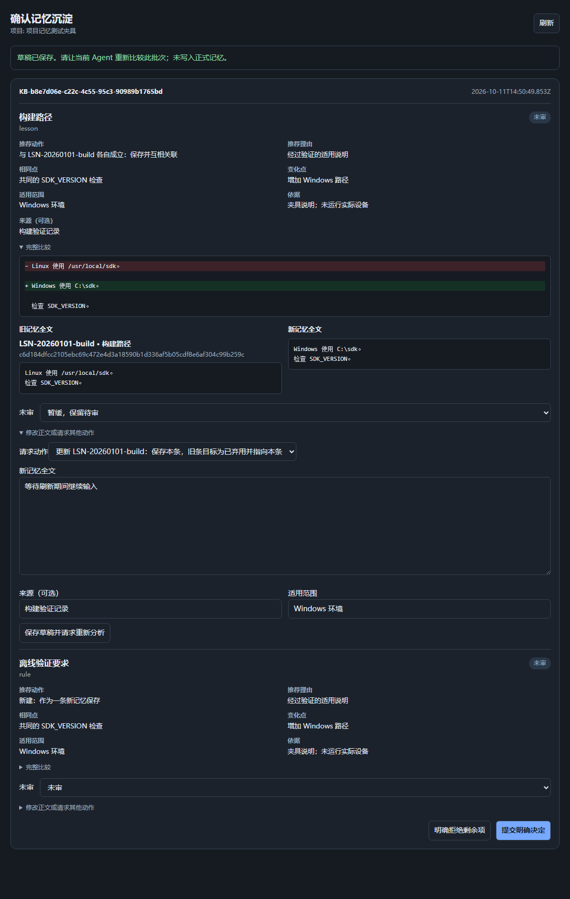

# 第四阶段：审批与决定去重

- 日期：2026-10-11；未发布，现有 0.2.6 安装包不包含这些改动。
- 截图来自本机 Chromium 加载实际 renderer 页面、内存后端返回的真实展示模型和模拟 pluginBridge；未安装插件、未修改项目正式记忆。

## 审批面板





推荐动作、理由、相同点、变化点、范围、依据可直接看到；展开后提供完整原文和新正文。行级差异超过 160,000 单元或合计 1,600 行时完整并列显示原文。

## 明确操作

| 操作 | 结果 |
|---|---|
| 未审（默认） | 不提交决定，继续待审 |
| 采用已分析建议 | 核对当前批准和所有比较版本后写入 |
| 暂缓 | 保留待审，可恢复；不产生拒绝指纹 |
| 与指定已比较条目重复 | 用户明确非写入结论，记为 duplicate |
| 不保存 | 明确拒绝，记为 rejected |
| 修改正文/来源/范围或请求其他动作 | 保存新草稿，旧分析/批准失效，当前 Agent 重新比较后才能批准 |

编辑区有未提交变化时点击采用建议会停止，要求先重新分析。合法指定目标保持原动作，即使候选排序变化也不静默切换。字段明确清空后不会继承旧值。

## 本次代码实际生成的聊天卡片

```json
{
  "questions": [
    {
      "question": "[PM b8e7d06e 1/2] [REV c30157fdadd0f101ca4104c03c54e1beac1c3daf4501d5bec872a2b099a396cd] 经验：构建路径（经过验证的适用说明）\n比较目标：LSN-20260101-build\n旧正文片段：Linux 使用 /usr/local/sdk。 检查 SDK_VERSION。\n新正文片段：Windows 使用 C:\\sdk。 检查 SDK_VERSION。\n变化：增加 Windows 路径\n适用范围：Windows 环境\n依据：夹具说明；未运行实际设备\n片段已限长；完整差异、修改及其他动作请打开确认面板。",
      "options": [
        "推荐 · 与 LSN-20260101-build 各自成立：保存并互相关联",
        "与 LSN-20260101-build 重复：不保存",
        "暂缓：保留待审",
        "不保存"
      ]
    },
    {
      "question": "[PM b8e7d06e 2/2] [REV c30157fdadd0f101ca4104c03c54e1beac1c3daf4501d5bec872a2b099a396cd] 规则：离线验证要求（经过验证的适用说明）\n比较目标：—\n旧正文片段：—\n新正文片段：测试夹具使用离线环境验证。\n变化：增加 Windows 路径\n适用范围：Windows 环境\n依据：夹具说明；未运行实际设备\n片段已限长；完整差异、修改及其他动作请打开确认面板。",
      "options": [
        "推荐 · 新建：作为一条新记忆保存",
        "暂缓：保留待审",
        "不保存"
      ]
    }
  ]
}
```

动态标记为本次夹具结果；真实批准必须原样调用当次返回的参数。聊天片段有限，完整差异/编辑/替代写入在确认面板中处理。

## 决定去重

- 本地 inbox/.decisions.json 存 SHA256 指纹、状态、actor、短理由和时间；保留 30 天、最多 1,000 条且不超过 240,000 字节，数量可能因字节上限提前缩减。
- 指纹覆盖知识内容、动作、目标/比较版本、范围、来源与依据；同一待审批次返回原身份，不产生第二张卡。
- 新证据、内容或版本变化、到期或用户明确要求（propose 的 reReview=true）允许重审；不跳过比较或批准。
- 用户决定与 Agent 重复分析分开标记。账本损坏/不可读只影响提示去重，不能授权写入。
- 来源字段 origin、适用范围 scope 可随正式条目保存，视图显示相关/替代关系和共存条件。

## 重跑验证

Node 22+，本仓库零 npm 依赖：

```powershell
node --test
```

浏览器需已有 Python Playwright 与本地 Chromium；脚本不会安装依赖。PI_SCRATCH_DIR 必须指向临时输出目录。本次使用已有 D:\AllSoftwares\miniconda\python.exe：

```powershell
node .\test-support\review-browser-fixture.cjs
& 'D:\AllSoftwares\miniconda\python.exe' .\test-support\review-browser.py
```

输出夹具、报告与截图全部进入 PI_SCRATCH_DIR。8 组实际 DOM 检查：默认未审与完整比较、脏草稿不批准旧内容、刷新输入/焦点、修改失败保留草稿、仅提交明确决定与暂缓、修订只请求分析、深浅主题和 480px 窄屏、项目切换隔离。当前输出 pageErrors=[]。

## 未验证与后续范围

真实安装态注册、宿主实际聊天/面板和完整重启场景未执行；离线 bridge 检查不等同宿主安装验证。任务生命周期、压缩续接及零工具调用关键正文提供属于第五段。

参见[分段计划](../plans/2026-10-10-memory-workflow-improvement.md)、[设计说明](../../DESIGN.md)与[第三阶段工具链](2026-10-11-memory-comparison.md)。
